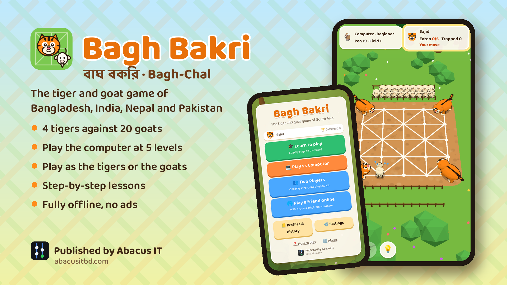
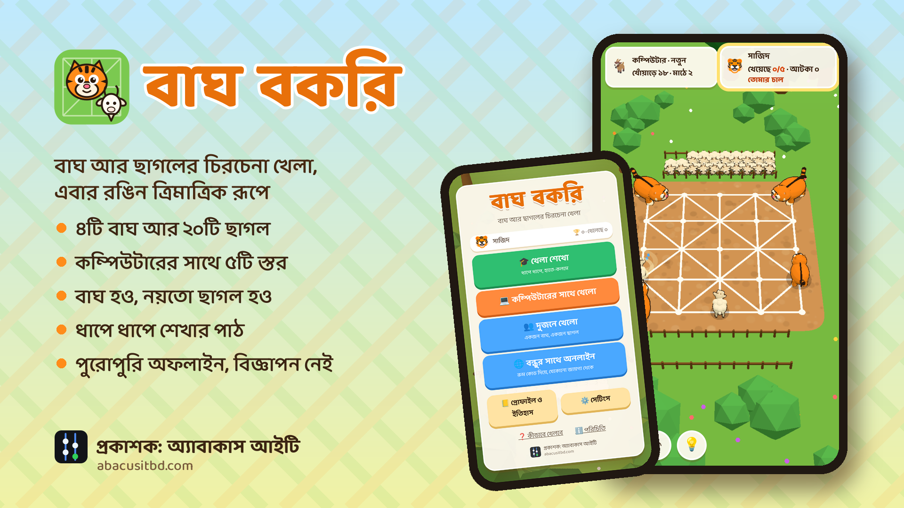

# Bagh Bakri (বাঘ বকরি)

**The tiger and goat hunt board game of Bangladesh, India, Nepal, Pakistan and Sri Lanka, in cartoon 3D.** Free, offline, no ads. By [Abacus IT](https://abacusitbd.com).

## Download

| Platform | Get it |
|---|---|
| **Play in the browser** (iPhone, iPad, any computer) | **[Play now](https://riadul.github.io/bagh-bakri-download/play/)** |
| **Android** 8+ | [BaghBakri.apk](https://github.com/riadul/bagh-bakri-download/releases/latest/download/BaghBakri.apk) (allow "install unknown apps" when asked) |
| **Windows** 10/11 | [BaghBakri-Setup-x64.exe](https://github.com/riadul/bagh-bakri-download/releases/latest/download/BaghBakri-Setup-x64.exe) |
| **Linux** | [Snap Store](https://snapcraft.io/bagh-bakri): `sudo snap install bagh-bakri`, or the AppImage / .deb on the [releases page](https://github.com/riadul/bagh-bakri-download/releases/latest) |

## About the game

Bagh Bakri (also called Bagh-Chal, Bagh Bandi, Wagh Bakri, Sher Bakri, Aadu Puli Aattam or Tigers and Goats) is the
old hunt game of South Asia, played for centuries on lines drawn in village courtyards and carved into temple stones.

- 4 tigers against 20 goats on the classic 5 x 5 board. Play as the tigers or as the goats
- Play the computer at 5 levels (Beginner, Easy, Medium, Hard, Expert), or a friend on one device
- Online play with a friend by room code (switching on very soon)
- The tiger roars and pounces, the goat trembles and cries, the herd jumps in fear
- Step-by-step lessons; a forest clearing, a village yard and a sunset field
- Profiles, statistics as tiger and as goat, match history; saved after every move; undo and hints
- Fully offline, no ads, no account, no data collected; Bangla and English

**How to play:** the goats come onto the board one by one, then move along the lines. A tiger moves one step, or
jumps over a goat next to it, to the empty point behind, and eats it. The tigers win by eating 5 goats. The goats
win by surrounding the tigers so that no tiger can move.

---

## বাংলায়

**বাংলাদেশ, ভারত, নেপাল আর পাকিস্তানের চিরচেনা বাঘ বকরি খেলা, রঙিন ত্রিমাত্রিক রূপে।** সম্পূর্ণ ফ্রি, অফলাইন, কোনো বিজ্ঞাপন নেই। প্রকাশক: [অ্যাবাকাস আইটি](https://abacusitbd.com)।

| কোথায় খেলবে | ডাউনলোড |
|---|---|
| **ব্রাউজারে** (আইফোন, আইপ্যাড, যেকোনো কম্পিউটার) | **[এখনই খেলো](https://riadul.github.io/bagh-bakri-download/play/)** |
| **অ্যান্ড্রয়েড** ৮ বা নতুন | [BaghBakri.apk](https://github.com/riadul/bagh-bakri-download/releases/latest/download/BaghBakri.apk) (জিজ্ঞেস করলে "অজানা অ্যাপ ইনস্টল" চালু করো) |
| **উইন্ডোজ** ১০/১১ | [BaghBakri-Setup-x64.exe](https://github.com/riadul/bagh-bakri-download/releases/latest/download/BaghBakri-Setup-x64.exe) |
| **লিনাক্স** | [স্ন্যাপ স্টোর](https://snapcraft.io/bagh-bakri): `sudo snap install bagh-bakri` |

- ৪টি বাঘ আর ২০টি ছাগল। বাঘ হয়ে ছাগল খাও, নয়তো ছাগল হয়ে বাঘদের ঘিরে আটকে ফেলো
- কম্পিউটারের সাথে ৫টি স্তর (নতুন, সহজ, মাঝারি, কঠিন, ওস্তাদ), অথবা একই ফোনে বন্ধুর সাথে
- রুম কোড দিয়ে বন্ধুর সাথে অনলাইন খেলা (খুব শিগগিরই চালু হবে)
- আসল বোর্ডে ধাপে ধাপে শেখার পাঠ; নিজের প্রোফাইল, হিসাব আর খেলার ইতিহাস

**কীভাবে খেলবে:** ছাগলগুলো একটা একটা করে বোর্ডে আসে, তারপর দাগ ধরে চলে। বাঘ এক ঘর চলে, অথবা পাশের ছাগলের ওপর দিয়ে
পেছনের খালি ঘরে লাফ দিয়ে ছাগলটা খেয়ে ফেলে। ৫টি ছাগল খেলে বাঘ জেতে। বাঘদের এমনভাবে ঘিরে ফেলো যেন কোনো বাঘ আর নড়তে না
পারে, তাহলে ছাগল জিতবে।

*Keywords: bagh bakri, baghbakri, bag bakri, bagh bokri, bag bokri, bagh chal, bagh-chal, baghchal, bagh bandi, bagh bondi, bagh chhagol, wagh bakri, sher bakri, aadu puli aattam, puli meka, huli kuri, tigers and goats, tiger and goat game, lambs and tigers, hunt game, desi board game, bangladesh, india, nepal, pakistan, sri lanka, বাঘ বকরি, বাঘবন্দী, বাঘ ছাগল, बाघ बकरी, बाघचाल, बाघ चाल, बाघ बंदी, शेर बकरी, वाघ बकरी, باگھ بکری, شیر بکری, باگھ چال, વાઘ બકરી, ਬਾਘ ਬੱਕਰੀ, ବାଘ ଛେଳି, ஆடு புலி ஆட்டம், పులి మేక, ಹುಲಿ ಕುರಿ ಆಟ, ആടുപുലിയാട്ടം, කොටි සහ එළුවන්*
